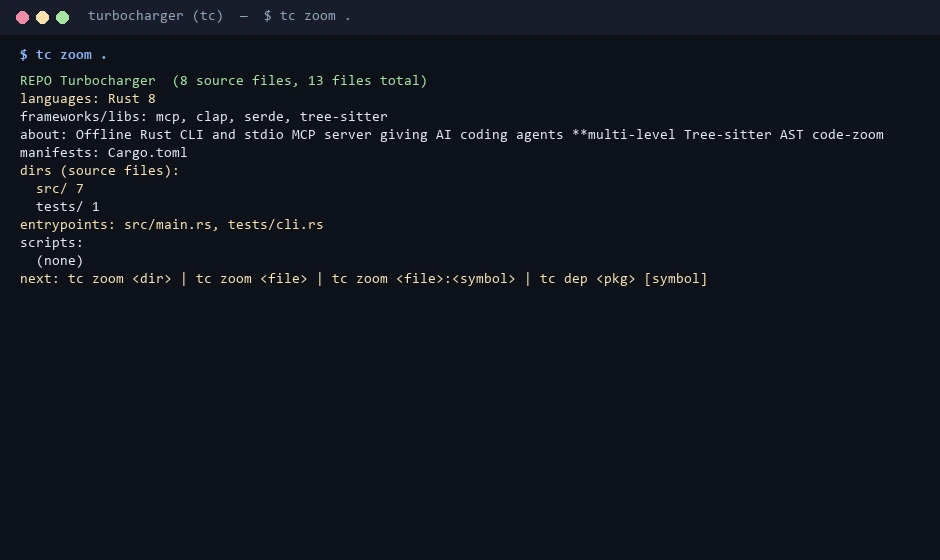

# Turbocharger (`tc`)

[](https://github.com/Boughzala-ayoub/turbocharger/actions/workflows/ci.yml)

Offline Rust CLI and stdio MCP server giving AI coding agents **multi-level Tree-sitter AST code-zoom** and **exact installed dependency signatures** (Node `node_modules`, Python venvs, Cargo registry) — with zero LLM calls, zero network access, and zero package execution.

<p align="center">
  
</p>

1. **What does this code look like at the zoom level I need?** `tc zoom` gives a repo map (`L0`), a directory's public API (`L1`), a file's symbol table (`L1.5`), or one symbol's body with its callees, installed dependencies used, and callers (`L2`).
2. **What does the installed version of this dependency actually export?** `tc dep` reads `node_modules`, Python venvs, and the Cargo registry directly from disk and prints exact signatures and docs — suggesting the real symbol name when an API was renamed. *(The CLI-only `tc dep --bin <cmd>` flag is the sole subcommand that executes a local binary with `--help`.)*

Every call is logged locally with the tokens it printed and an estimate of the tokens in the files the agent didn't have to read, so `tc stats` can show the saving.

Languages: TypeScript/JavaScript (`.ts .tsx .js .jsx .mjs .cjs .d.ts`), Python (`.py .pyi`), Rust (`.rs`), Java (`.java`). Parsing uses tree-sitter.

## Install

```sh
cargo install --git https://github.com/Boughzala-ayoub/turbocharger
# or from a local clone:
cargo install --path .        # puts `tc` on PATH
tc init                       # optional: wire it into AGENTS.md / CLAUDE.md / .mcp.json
```

## `tc zoom <target>`

| Target | Level | Output |
|---|---|---|
| `.` | L0 | languages, frameworks, manifests, biggest dirs, entrypoints, scripts (300 to 500 tokens) |
| `src` | L1 | every source file with its exported/public symbols, one-line signatures and doc summaries, no bodies |
| `src/app.ts` | L1.5 | all symbols with line ranges, plus each import tagged internal, stdlib, or `pkg <installed version>` |
| `src/app.ts:run` | L2 | the four sections below |

L2 sections, in priority order:

- `TARGET` is the symbol's source with line numbers, including its doc comment and decorators. It is cut at the symbol's own bytes, so a second function on the same line stays out.
- `INTERNAL CALLEES` lists the project functions it calls, as one-line signatures with `file:line`. Resolution uses imports, same-file symbols, same-package Java classes and same-crate Rust files. Member calls only resolve when the receiver's declared type names the class (`WorkingHoursRepository workingHoursRepository`), so `lines.push()` doesn't get matched to some unrelated `push` method. Each definition is listed once, so `a.run()` and `b.run()` on different classes give two entries.
- `INSTALLED DEPS USED HERE` shows the third-party names used inside the symbol, with the installed version and signature.
- `CALLERS / BLAST RADIUS` lists every reference in the repo outside the definition, honouring `.gitignore`.

Symbols can be qualified: `file.java:SlotService.getFreeSlots`, `lib.rs:Point::norm`. Windows paths with drive letters work.

`--filter <text>` narrows a directory or a file to the symbols whose name or signature contains `<text>`. Case is ignored with full Unicode case folding, so `Σ` finds `ΟΣ` and `STRASSE` finds `straße`; `İ` and `ı` both fold to `i`. A constant or field matches on its name and type, never its value: the parser marks where the initializer starts, so `Gs="Terminal input"` doesn't match `terminal input` while `const foo: ResizeMode = "x"` matches `ResizeMode`. Rust struct fields are searched too, so `emitted` finds `ReportState.emitted`. A match keeps the headers above it: its class, trait, impl or struct, and every Rust `mod` it sits in. A Rust impl method whose type lives in another file ends with `(in Type)` instead. At L1 the filter searches every declaration in the directory, private ones included, and drops the files with no match. At L1.5 it drops the imports that don't name `<text>` before resolving them. On loom, `tc zoom src-tauri --filter resize` lists `resize_pty` and `pty_resize` (under `mod commands`) in about 170 tokens; the full symbol table of that 3,259-line `lib.rs` is about 6,750. `--filter` on `.` or on `file:symbol` exits with code 2, and a blank pattern means no filter. A pattern that starts with `-` needs the equals form, `--filter=-term`. `tc stats` counts only the files the filtered view shows.

Under `--budget`, a match outranks the headers above it. A filtered view that doesn't fit whole is tried again with the matches alone. If that doesn't fit either, the cut view keeps its headers as long as it still shows a match, and otherwise falls back to the cut matches. This holds at L1 and L1.5, text and `--json`. With `--json` at L1, a file entry too big to fit keeps the first symbols that do, provided they reach a match; an entry left with only headers is dropped.

`--budget <tokens>` caps the whole printed output, headers and cut markers included (default 8000, `0` means unlimited). Tokens are counted the way `tc stats` counts them, characters / 4. Output that fits whole is printed whole, with no room held back for markers. Otherwise lines are cut from the lowest-priority section first, callers, then deps, then callees, then the tail of the target. Once a section is cut, every later one is cut too, and each cut leaves a `… N more lines cut by --budget` marker. When even the headers don't fit, whole header lines are dropped from the end. With `--json` the arrays (`callers`, `deps`, `callees`, `body` at L2) are trimmed until the pretty-printed JSON fits; below about 10 tokens only `{"level", "truncated"}` or `{}` is left. It never errors.

`zoom` walks the tree with `.gitignore` rules. It always skips `node_modules`, `target`, `__pycache__`, `site-packages`, hidden directories and any directory holding a `pyvenv.cfg`. Names like `build`, `dist` or `env` are walked unless `.gitignore` excludes them. Declarations nested deeper than 48 levels (modules, classes, namespaces, blocks) are left out instead of overflowing the stack.

## `tc dep`

```sh
tc dep @xterm/xterm IBufferLine     # interface + every member with docs and its line
tc dep mcp MCPServer                # class, __init__ signature, public methods, shortest import path
tc dep mcp FastMCP                  # NOT FOUND + "did you mean: MCPServer" + the line that says it was renamed
tc dep torch.cuda is_available      # look inside a submodule
tc dep numpy                        # version, entry file, exported names
tc dep --imports server.py          # cheat sheet for every third-party import in a file
tc dep --bin cargo --flag --locked  # the matching lines of `cargo --help` (CLI only, runs cargo)
```

A class, interface or trait prints each member with its own line in the same file, as in `[:1157] registerDecoration(...)`, so you don't need a second lookup to find it. In `--json` every member has the same `line`. A class in a `.d.ts`, `.d.mts` or `.d.cts` file also lists its `private` and `#private` fields, since TypeScript checks them when it compares two classes. Runtime `.ts`, `.py` and `.rs` sources keep hiding private members. When a declaration has no inline `export` and an `export { ... }` statement later in the same file makes it public, the header gives both lines, `[core.d.ts:103, export :445]`, and `--json` adds `export_line`.

Where it looks:

- Node reads `node_modules/<pkg>/package.json` (`exports` conditions, `types`, `typings`, `main`), walking up from the cwd. A subpath such as `pkg/sample` starts from that subpath's own `exports` entry. A name counts as public only when an export edge reaches it: `export` declarations, `export { a as b }`, `export ... from` and `export * from`. A plain `import` inside a barrel doesn't make a name public. Aliases keep their public name, so `export { IBuf as IBufferLine }` lists `IBufferLine` and `IBufferLine.isWrapped` resolves through it. `export = Lib` makes `Lib` the default export and the members of `namespace Lib` importable by name. A declaration file with no `export {…}`, `export *`, `export =` or `export default <expr>` statement exports every top-level declaration, as TypeScript does. Linked packages (workspaces, pnpm, Windows junctions) are read from their real location. If the package ships no types it falls back to `@types/<pkg>`. A CommonJS entry with no ES exports falls back to scanning the files it imports.
- Python finds the nearest `.venv`, `venv` or `env` with a `pyvenv.cfg`, or `$VIRTUAL_ENV`, and reads `Lib/site-packages` on Windows or `lib/python*/site-packages` on Unix. When `include-system-site-packages = true` it also reads the base interpreter's site-packages and the user site. The version comes from `*.dist-info/METADATA`. The module-to-dist mapping uses the dist name, then `top_level.txt`, then `RECORD`. `.pyi` stubs win over `.py`, and a standalone `module.pyi` counts as installed. A lookup follows `from x import a as b` and `from x import *` from the module you named, across packages and through several hops, so `from pkg import Public` is printed even when `Public` is `_impl.Source` in another package. A dotted module (`tc dep wrong.real Thing.wrong`) stays inside that module. For a member, the import line names its class. Python is never executed.
- Rust takes the version from `Cargo.lock` and reads `~/.cargo/registry/src/*/<crate>-<version>/` (or `$CARGO_HOME`). When the lock has several versions of a crate, it uses the one the current workspace member (nearest `Cargo.toml`) depends on, then the only one reachable from it. If that still leaves several, the label says `ambiguous` and lists them. It follows `pub use other_crate::*` re-exports, so `tc dep clap Parser` lands in `clap_builder`.
- `--bin <cmd> [--flag <flag>]` resolves `<cmd>` on `PATH`, or relative to `--cwd` when it contains a slash, and runs `<cmd> --help` from `--cwd`. One 3-second deadline covers the exit and both output pipes. On expiry the whole process tree is killed (a Job Object on Windows, the process group on Unix). Each stream keeps at most 512 KiB, and a nonzero exit is an error.

Suggestions on a miss rank candidates by edit distance, substring and camelCase token overlap (`FastMCP` and `MCPServer` share `MCP`). Names that appear on the same line as the missing name in the package's own source get a large boost, which is how a "`FastMCP` is now `MCPServer`" note becomes the first suggestion.

A miss exits with code 1 and still prints the suggestions on stdout.

## `tc mcp`

Newline-delimited JSON-RPC 2.0 on stdin/stdout, with logs on stderr. It speaks protocol version `2025-06-18` only and doesn't accept batches. Handles `initialize`, `notifications/initialized`, `ping`, `tools/list` and `tools/call`. `tc --cwd <dir> mcp` makes `<dir>` the project root for calls that pass no `cwd`. Tools:

- `turbo_zoom` takes `target`, plus optional `cwd`, `budget` and `filter`. A `filter` on `.` or `file:symbol` comes back as an `isError: true` result, and an empty one counts as absent.
- `turbo_dep` takes `package` (with optional `symbol`) or `imports_file`, plus optional `cwd`. It has no `bin` or `flag`: running an executable is CLI-only.
- `turbo_stats` takes optional `cwd` and `reset`.

A failed tool call, including a dependency miss, comes back as an `isError: true` result. Unknown tools, unknown or mistyped arguments, and `bin`/`flag` get `-32602`. A message without `"jsonrpc": "2.0"`, a string `method` or a string/number `id` gets `-32600`, and a message without `id` is a notification that gets no reply. Malformed JSON, invalid UTF-8 and frames over 4 MiB get `-32700`, and the session keeps going. Unknown methods get `-32601`.

## `tc init`

`tc init` with no flags does both of these. `--agents` and `--mcp` pick one, `--all` is explicit, and `--dry-run` prints what would change.

- It writes a short block between `<!-- turbocharger:start -->` and `<!-- turbocharger:end -->` into `AGENTS.md` (created if missing) and into `CLAUDE.md` if that file exists. Running it again replaces the block in place and leaves every byte outside it alone. The markers only count as whole lines, and anything other than one start line followed by one end line (a lone, swapped or repeated marker) is an error.
- It adds `mcpServers.turbocharger = {"type":"stdio","command":"tc","args":["mcp"]}` to `.mcp.json` and keeps the other servers and key order. A `turbocharger` entry you changed is kept and reported as a conflict.
- It reads and checks every target before writing any of them, so invalid JSON or bad markers leave all three files as they were. Each file is written to a temp file in the same directory and renamed over the original.

## `tc stats`

Each `zoom` and `dep` call (CLI or MCP) appends one JSON line to `.turbocharger/stats.jsonl` at the git root, or at the cwd when there is no git root. If that location isn't writable the line goes to `~/.turbocharger/stats.jsonl`. Set `TC_STATS_FILE` to keep one ledger across repos. The first write also creates `.turbocharger/.gitignore` containing `*`, so the directory never shows up in `git status`. `--no-stats` skips recording for that call. Each record is one write under an exclusive file lock, so parallel `tc` processes don't interleave lines.

Fields: timestamp, tool and level, target, latency in ms, `actual_tokens` (characters of what was printed, JSON with `--json`, / 4), `baseline_tokens`, dependency lookups, and whether the answer was found. `baseline_tokens` is an estimate of a full-file read: the bytes of every file that contributed visible output (the target file, the callee files shown, the `.d.ts`/`.pyi`/`.py` file of each shown answer), / 4, each file counted once. Files that were scanned but cut by `--budget`, or only listed as `also defined`, don't count.

`tc stats` prints call count, average/p50/max latency, emitted vs. estimated baseline tokens, net saved, the multiplier (`~X.X× stretch`), how many `--bin` calls ran a command, and a per-tool breakdown. Lines it can't read (bad JSON, invalid UTF-8, out-of-range numbers) are skipped and counted, and totals saturate instead of overflowing. `--json` prints the same as JSON. `--reset` empties only the ledger this repo resolves to (or `$TC_STATS_FILE`), under the same lock. It never falls back to the home ledger; to reset that one, point `TC_STATS_FILE` at it.

## Global flags

`--json` prints structured output. `--cwd <dir>` sets the project root for every command, including the default root of `tc mcp` tool calls and where `dep --bin` resolves and runs its command. `--no-stats` disables recording. Set `TC_TIMING=1` to print in-process latency to stderr.

## Measured on this machine

Release build, Windows 11, in-process time from `TC_TIMING=1`. Process start adds about 10 ms on top of these.

| Call | Time |
|---|---|
| `tc dep @xterm/xterm IBufferLine` (loom) | 8 to 10 ms |
| `tc dep mcp MCPServer` (earmcp, 124-file package) | 15 to 18 ms |
| `tc dep mcp FastMCP` (miss with suggestions) | 17 to 19 ms |
| `tc dep torch no_grad` (2,230 Python files) | 20 ms |
| `tc dep torch cat` (no import hint, full scan) | about 140 ms |
| `tc zoom server.py:transcribe` | 9 to 11 ms |
| `tc zoom src/pane_events.ts:bufferLines` (loom, 122 source files) | 28 to 31 ms |
| `tc zoom SlotService.java:getFreeSlots` (booking app, 123 source files) | 39 to 41 ms |
| `tc zoom src/main.ts` (L1.5 of an 11,724-line file) | about 140 ms |
| `tc dep --imports server.py` (librosa, numpy, torch, transformers, mcp, matplotlib) | about 1.0 s |

On those smoke runs the three L2 views printed 2.5k tokens against 16k tokens of files they replaced (6.3×). The `--imports` and `dep` baselines are upper bounds: they count the full size of every stub file an answer came from, and torch's `_VF.pyi` alone is several MB.

## Known limitations

- Callers and blast radius are textual: identifier-boundary matches (Unicode-aware, so `αf` doesn't match `f`) minus definitions, imports and comment lines. String literals that contain the name are reported too. Common method names (`get`, `fresh`) can pick up calls on unrelated receivers.
- Callee resolution is heuristic, with no type inference. A call through an untyped local or a return value isn't resolved. Calls into inherited framework methods (Spring Data's `findById`) are not shown, which is correct, because they aren't in the project.
- Java dependencies are listed but not version-resolved. Maven and Gradle resolution, and reading `.jar` files, are not in v0.1.
- JavaScript packages without `.d.ts` files fall back to parsing the JS entry, which finds declared functions and classes but not `module.exports = {...}` patterns or `require()` calls.
- Python lookups follow the requested module's imports to the defining module. Packages that build their namespace at runtime (torch's `_C`, transformers' lazy `_import_structure`) fall back to a full scan, which takes 100 to 300 ms for the largest packages. A dotted module lookup scans only that module.
- Node export edges are followed inside one package and at most 64 files deep. `export * from 'other-pkg'` into another package is not followed, and neither are `exports` patterns with `*`.
- In `zoom` views, Rust public API means `pub` inside a chain of `pub` modules. `pub(crate)`, `pub(super)` and items in private modules are left out, even when a `pub use` re-exports them.
- Without a venv, Python lookups use the `python` on PATH, with the Windows layout only.
- Go, C# and other languages are not parsed.

## Development

```sh
cargo test            # 20 unit + 36 end-to-end tests against throwaway fixture repos
cargo build --release
```
